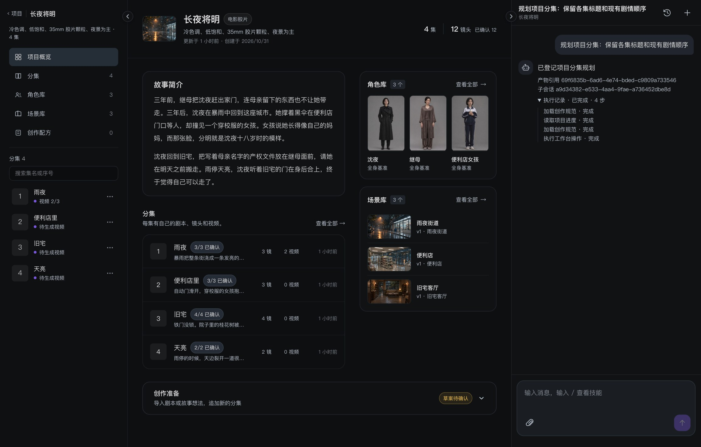
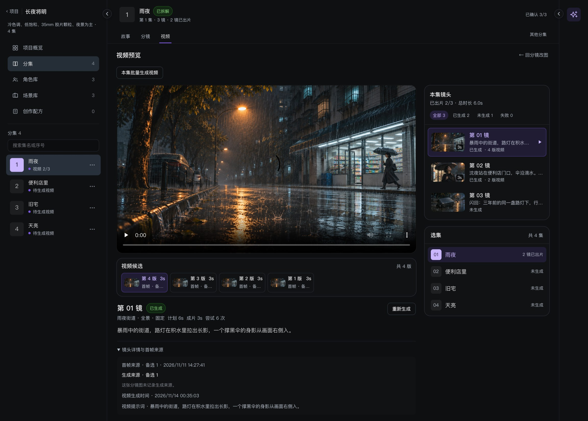

<h1 align="center">
  
</h1>

<p align="center"><strong>AI 短剧前期制作工作台</strong></p>

<p align="center">
  从故事想法或剧本出发，规划分集、编辑镜头、挑选分镜图，再用确认的画面生成视频片段。<br>
  每张分镜图保留生成时使用的人物与场景版本，每段视频保留提交时使用的首帧。
</p>

<p align="center">
  <a href="#快速开始">快速开始</a> ·
  <a href="#工作台截图">工作台截图</a> ·
  <a href="#架构与工程">架构与工程</a> ·
  <a href="#验证与文档">验证与文档</a>
</p>

## 快速开始

先安装 **Node.js 22.20+（22.x）或 24.12+（24.x）**。在终端克隆仓库并安装前端依赖。

```bash
git clone https://github.com/rerohierophant/VibeStory.git
cd VibeStory
npm ci --prefix apps/web
```

### 只启动前端，查看离线演示

```bash
npm run dev --prefix apps/web
```

打开 [http://localhost:5173](http://localhost:5173)。API 未启动时，直接使用登录页预填的演示账号进入《长夜将明》。编辑内容保存在当前浏览器。

### 启动完整 Mock 工作台

准备 **JDK 21**，以及 **Docker Compose** 或本机 **PostgreSQL 16**。从仓库根目录执行：

```bash
cp -n .env.example .env
```

在 `.env` 中填写 `DATABASE_PASSWORD`，设置 `MOCK_ONLY=true`，保留 `TEXT_PROVIDER`、`IMAGE_PROVIDER` 和 `VIDEO_PROVIDER` 为 `mock`。使用本机 PostgreSQL 时，先创建数据库，并将 `DATABASE_URL`、`DATABASE_USER`、`DATABASE_PASSWORD` 指向它。

```bash
# 使用 Docker Compose 时启动 PostgreSQL，等待健康检查通过
docker compose --env-file .env -f infra/docker-compose.yml up -d --wait postgres

# 启动 API 和数据库 Worker，Flyway 会初始化数据库
scripts/dev-api.sh
```

macOS 脚本会自动选择 JDK 21，其他平台需设置 `JAVA_HOME`。在另一个终端运行 `npm run dev --prefix apps/web`，打开 [工作台](http://localhost:5173)，点击「注册账号」。API 默认监听 `127.0.0.1:8080`，接口可在 [Swagger UI](http://127.0.0.1:8080/swagger-ui.html) 查看。

注册后可新建个人项目，在「创作准备」里输入故事想法或上传整稿，审阅并确认分集草案。进入一集后点击「AI 拆解镜头」，在角色库与场景库为引用的素材准备基准图，再生成分镜图、确认画面并切到「视频」提交生成。完整链路使用本地 Mock，无需模型密钥。已有开发库的升级步骤见[迁移说明](docs/development.md#flyway-迁移)。

## 工作台截图

### 项目概览与 Agent 对话

在同一页查看故事简介、分集进度与素材。个人项目的 Agent 能协助规划分集、整理剧本、拆镜并提交已授权的生成任务。

[](docs/media/project-overview.jpg)

### 分镜工作台

分镜表支持逐镜编辑、查看参考素材、比较候选和确认画面。

[](docs/media/storyboard-demo.jpg)

### 视频工作台

切换镜头和视频版本，查看生成该版本时使用的首帧与提示词。

[](docs/media/video-workspace.jpg)

截图来自本地示例项目《长夜将明》。分镜使用导入的 ChatGPT 示例图，视频页展示 Mock 生成记录与播放器首帧。操作细节见[创作流程指南](docs/workflow.md)。

## 架构与工程

前端使用 **React 19、TypeScript、Vite、Tailwind CSS**。后端使用 **Java 21、Spring Boot 3、PostgreSQL 16、Flyway**。默认由数据库 Worker 领取任务，可选 RabbitMQ 派发和 Redis 共享准入。

| 设计 | 实现 |
| --- | --- |
| 长任务与恢复 | 持久化任务、执行尝试和租约。请求标识用于去重，任务状态区分可重试失败与外部结果未知。 |
| 作用域和版本 | 读写校验用户、项目与资源权限。提交生成时冻结资产版本或首帧，后续切换基准图和首帧时保留历史来源。 |
| Agent 与业务工具 | 主 Agent 按需加载版本化 Markdown Skill，调度剧本与分镜子 Agent。页面和对话共用业务工具与版本校验。 |

代码入口为 [Web 工作台](apps/web/)、[业务 API 与 Worker](apps/api/)、[Agent 工具契约](apps/agent/)、[本地 MCP](apps/mcp/)和[共享 API 契约](packages/contracts/)。

<details>
<summary>在 Codex 中使用本地 MCP</summary>

启动上面的 Mock API，确保 `.env` 中配置了可登录账号的 `SEED_EMAIL`、`SEED_PASSWORD`，或为 MCP 提供 `VIBESTORY_MCP_EMAIL`、`VIBESTORY_MCP_PASSWORD`。运行 `scripts/java21.sh :mcp:installDist`，再在 Codex 中打开并信任仓库、重新开启会话。[项目配置](.codex/config.toml)通过本地 STDIO 注册 `vibestory`，写工具使用审批模式。API 地址可通过 `VIBESTORY_MCP_URL` 覆盖。

MCP 可读取已有分集、按正文版本保存修改、预览并应用单镜改动，以及提交拆镜、分镜图和视频任务。也可查询最近的生成批次、镜头候选与首帧来源。媒体地址在已登录的工作台中打开。

</details>

## 验证与文档

全量 Mock 回归入口为 [`scripts/verify-all-mock.sh`](scripts/verify-all-mock.sh)，覆盖后端、契约、前端组件、类型与构建、HTTP 崩溃恢复和 Chrome 工作流。运行条件和验证范围见[本地开发与验收](docs/development.md)。

- [工作台、Agent 与团队协作](docs/workflow.md)
- [任务、版本与故障恢复](docs/architecture.md)
- [设计系统与品牌](design/README.md) · [素材来源与署名](design/assets/STYLE_SOURCES.md)
- [阶段归档](docs/archive/README.md)
