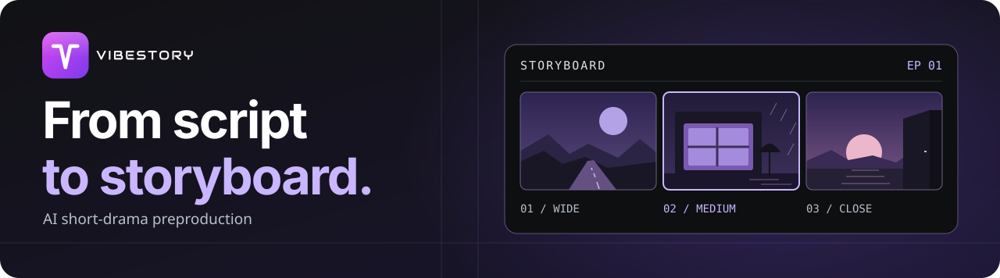
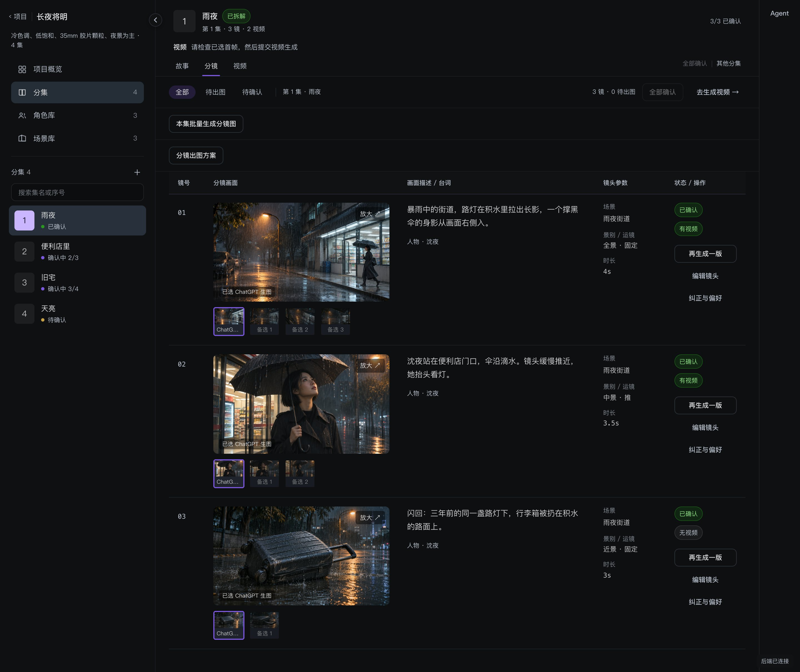

<h1 align="center">
  
</h1>

<p align="center"><strong>AI 短剧前期制作工作台</strong></p>

<p align="center">
  从故事正文到可审阅的分镜图和视频片段。<br>
  逐镜编辑与确认，保留每次生成使用的资产版本和首帧。
</p>

<p align="center">
  <a href="#创作流程">创作流程</a> ·
  <a href="#快速开始">快速开始</a> ·
  <a href="#架构与工程">架构与工程</a> ·
  <a href="#验证与文档">验证与文档</a>
</p>

## 创作流程

| 步骤 | 可以做什么 |
| --- | --- |
| **01 · 故事与分集** | 粘贴或上传剧本，按集整理。AI 拆解成包含场景、景别、运镜、台词和时长的镜头清单。 |
| **02 · 分镜与资产** | 逐镜编辑和确认，维护人物与场景的基准版本，生成分镜图并比较候选。 |
| **03 · 视频与回改** | 以选定分镜图为首帧生成视频。回改镜头或换首帧后，可按需重新生成，并追溯已有产物的来源。 |



*《长夜将明》第 1 集「雨夜」的分镜工作台截图。画面展示导入本地开发库的 ChatGPT 分镜图，三镜分别有 3、2、1 张备选。*

个人项目支持从 Agent 对话里整理剧本、规划分镜和推进已明确授权的操作。对图片给出纠正后，可以比较新旧候选，并在明确满意时将要求保存为指定范围的偏好或可填参的配方。详情见[创作流程指南](docs/workflow.md)。

## 快速开始

**先看界面** · 安装 Node.js 22.12+，在仓库根目录执行：

```bash
npm ci --prefix apps/web
npm run dev --prefix apps/web
```

打开 [http://localhost:5173](http://localhost:5173)。后端未启动时，使用登录页预填的演示账号即可进入样例项目，数据保存在当前浏览器。

**运行完整 Mock 链路** · 准备 JDK 21 与 PostgreSQL 16。可用本机 PostgreSQL，也可通过 Docker Compose 启动。

1. 在仓库根目录执行 `cp -n .env.example .env`。在 `.env` 填写 `DATABASE_PASSWORD`、`SEED_EMAIL`、`SEED_PASSWORD`，将 `MOCK_ONLY` 设为 `true`，并确认 `TEXT_PROVIDER`、`IMAGE_PROVIDER`、`VIDEO_PROVIDER` 均为 `mock`。使用本机数据库时，将 `DATABASE_URL` 和 `DATABASE_USER` 指向一个新库。
2. 使用 Docker 时，执行 `docker compose --env-file .env -f infra/docker-compose.yml up -d postgres`。待数据库就绪后运行 `scripts/dev-api.sh`。API 默认监听 `127.0.0.1:8080`，Flyway 会初始化数据库。
3. 在另一个终端按上面的方式启动前端，使用 `.env` 中设置的种子账号登录。新建项目和分集，完成拆镜、确认、分镜图和视频生成。

开发环境的 API 契约见 [Swagger UI](http://127.0.0.1:8080/swagger-ui.html)。macOS 启动脚本会选择已安装的 JDK 21。旧开发库若执行过缺少原文件的 V18 迁移，请按[迁移说明](docs/development.md#flyway-迁移)处理。

## 架构与工程

前端使用 **React 19、TypeScript、Vite、Tailwind CSS**。后端使用 **Java 21、Spring Boot 3、PostgreSQL 16、Flyway**。默认由数据库 Worker 领取任务。可选的 RabbitMQ 模式将 API 与 Worker 分开运行，Redis 可在该模式下提供共享生成准入。

| 设计 | 实现 |
| --- | --- |
| **长任务与恢复** | 任务和尝试持久化，以租约领取、续约与恢复；请求标识去重，区分主动重生成、可重试失败和外部执行结果未知。 |
| **生成来源** | 分镜图提交时冻结人物与场景版本，视频提交时冻结选定首帧。新版本和新候选各自保留来源。 |
| **Agent 与业务工具** | 主 Agent 按需加载版本化 Markdown Skill，调度剧本与分镜子 Agent。页面和对话共用受控工具、权限与版本校验。 |
| **上下文压缩** | 依次外置大工具结果、裁剪已消费的旧工具正文、摘要完整存档。原始记录可以在当前运行的权限范围内分页读取。 |

代码入口为 [Web 工作台](apps/web/)、[业务 API 与 Worker](apps/api/)、[Agent 工具契约](apps/agent/)、[本地 MCP](apps/mcp/)和[共享 API 契约](packages/contracts/)。

<details>
<summary>在 Codex 中使用本地 MCP</summary>

用当前源码启动上面的 Mock API，运行 `scripts/java21.sh :mcp:installDist`。在 Codex 中打开并信任仓库，再重新开启会话。[项目配置](.codex/config.toml)通过本地 STDIO 注册 `vibestory`，写工具使用审批模式。MCP 默认使用本机 `.env` 的种子账号和 `PORT`，也可通过 `VIBESTORY_MCP_EMAIL`、`VIBESTORY_MCP_PASSWORD`、`VIBESTORY_MCP_URL` 覆盖。

MCP 提供 17 个工具。可以读取已有分集、按正文版本保存修改、提交拆镜、预览和应用单镜改动、确认镜头，以及提交和查询 Mock 图片或视频批次。可按分集找回最近的批次，也可查看单镜的候选图、图片来源和视频使用的首帧。

例如发送「查《雨巷》第 2 集第 3 镜的候选图和当前首帧」。用户明确选图后，可指定这张图提交视频。提交前若首帧已变化，该镜会在批次里显示阻塞原因。媒体链接为工作台的鉴权 API 路径，可在已登录的工作台查看。

</details>

## 验证与文档

2026-11-05 的独立 PostgreSQL 16 全 Mock 验收通过 **189 项后端、17 项组件、17 项 Chrome 用例**，并覆盖类型、契约、构建与 HTTP 崩溃恢复。复现步骤和历史供应商验证范围见[本地开发与验收](docs/development.md)。

| 想了解 | 文档 |
| --- | --- |
| 启动、迁移与测试 | [本地开发与验收](docs/development.md) |
| 工作台、Agent 与团队协作 | [创作流程](docs/workflow.md) |
| 任务、版本与故障恢复 | [系统架构](docs/architecture.md) |
| 设计取舍与阶段证据 | [历史归档](docs/archive/README.md) |
| UI、品牌与素材来源 | [设计系统与品牌](design/README.md) · [素材来源与署名](design/assets/STYLE_SOURCES.md) |
